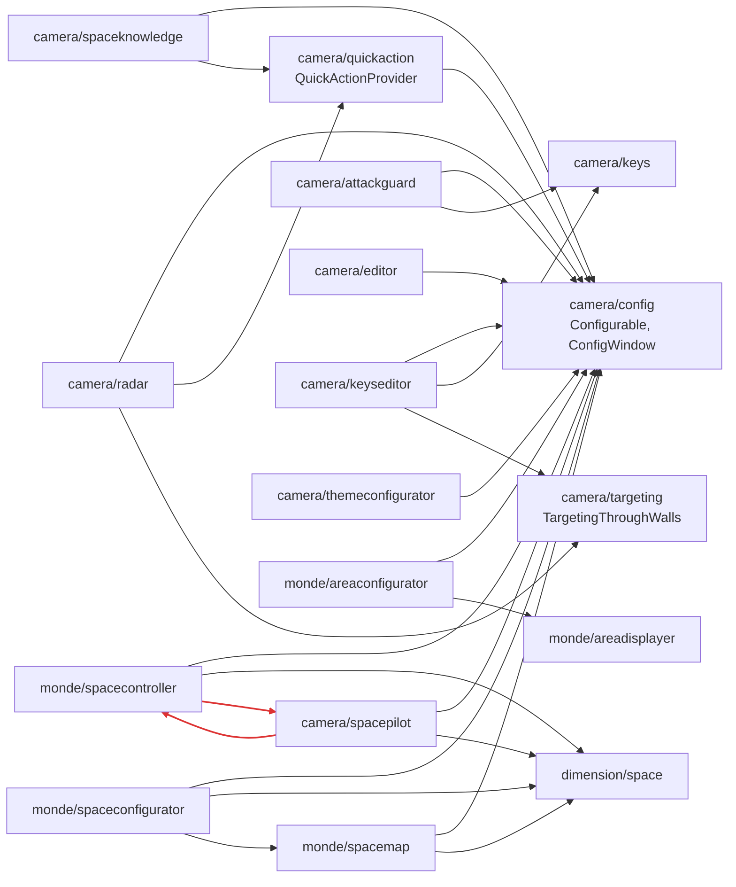

# Rapport d'examen n° 1 — Amynna Holo Lib

Date : 12 octobre 2026. Branche `dev`, avec les modifications non commitées présentes à cette date.
Périmètre : `src/main/java/com/amynna/hololib/` en entier (464 fichiers Java, environ 58 000 lignes) et les ressources.
Les chemins ci-dessous sont relatifs à ce package. Ce rapport ne modifie aucun code. Il complète `rapport.md`
(6 octobre), qui décrit le **fonctionnement** du mod ; celui-ci porte sur la **qualité**, la **performance**, le
**cloisonnement** et la **façon dont tout est lié**.

Méthode :
- mesures automatiques des imports entre couches et entre modules, des tailles de fichiers, de la réflexion et des
  abonnés aux événements ;
- lecture détaillée de trois zones : le socle commun (`holo/`, `network/`, `command/`), le socle client (`client/`
  hors modules) et les modules (`modules/`, `client/modules/`, `client/render/modules/`, `demo/`) ;
- vérification dans le code (et dans les sources Forge mappées) de chaque constat classé « haute » sévérité.

---

## Sommaire

1. [Synthèse](#1-synthèse)
2. [Schémas de la structure](#2-schémas-de-la-structure)
3. [Comment tout est lié](#3-comment-tout-est-lié)
4. [Séparation et cloisonnement](#4-séparation-et-cloisonnement)
5. [Qualité du code](#5-qualité-du-code)
6. [Optimisation](#6-optimisation)
7. [Robustesse et sécurité](#7-robustesse-et-sécurité)
8. [Recommandations priorisées](#8-recommandations-priorisées)
9. [Annexe : métriques](#9-annexe--métriques)

---

## 1. Synthèse

**Verdict.** L'architecture est saine et inhabituellement bien documentée pour un mod : la séparation modèle commun /
rendu client est réellement respectée, le framework ne connaît aucun module, le serveur fait autorité, et la
compatibilité Oculus / Embeddium sans Mixin est construite à partir des sources. Les dettes ne sont pas dans les
fondations. Elles se concentrent en quatre endroits :

- **les modules Space** : 10 000 lignes de code commun, avec des classes de 1 000 à 2 200 lignes qui mélangent
  quatre ou cinq responsabilités ;
- **le couplage entre l'édition et le cœur client** (routage, picking, miroirs), par dépendances circulaires ;
- **quelques trous de validation côté serveur**, dont deux bugs avérés (commande d'inspection, taille des actions) ;
- **l'absence totale de tests**, alors qu'une grande partie du code (mathématiques Space, règles d'édition) s'y
  prête.

| Axe | Note | Résumé |
|---|---|---|
| Architecture | 4,5 / 5 | modèle / rendu séparé, 4 familles de renderers, réplication d'état et non de widgets, mémoires robustes |
| Cloisonnement framework ↔ modules | 4 / 5 | aucune fuite du framework vers les modules ; mais des API de framework hébergées dans des modules, et un cycle entre modules |
| Cloisonnement interne du client | 3 / 5 | l'édition est tissée dans le routage, le picking et les miroirs ; l'ordre de dessin dépend du hasard du chargement |
| Qualité du code | 3,5 / 5 | commentaires excellents, méthodes courtes dans le socle ; god classes Space, duplications de placement et d'utilitaires de rendu |
| Performance | 3,5 / 5 | discipline d'allocation sérieuse ; quelques gros chemins re-émis à chaque frame (terrain Area, étoiles) et des budgets serveur par instance |
| Robustesse / sécurité | 3,5 / 5 | serveur autoritaire et validations nombreuses ; 4 failles de sévérité haute, toutes simples à corriger |
| Testabilité | 1 / 5 | `src/test` vide |

**Les 10 actions les plus rentables** (détail en section 8) :

1. Restreindre `/hololib_inspect <joueurs> <cibles>` à l'exécutant hors mode forcé (bug de permission).
2. Abaisser `HoloModuleActionPacket.MAX_PAYLOAD` sous la limite vanilla, borner `source` et vérifier la taille à
   l'envoi (bug de déconnexion).
3. Faire passer `handleMove` par les règles d'édition, ou au moins interdire le changement de famille d'ancrage.
4. Fermer les conteneurs de position au déchargement d'un niveau (fuite de l'ancien monde en solo).
5. Mettre `try/finally` autour du `pushPose` / `popPose` de `WorldRenderer.renderAll`.
6. Rendre l'ordre des renderers explicite (un seul point d'enregistrement ou une priorité).
7. Remonter `Configurable`, `QuickActionProvider` et le style des fenêtres de module dans le framework.
8. Casser le cycle `spacepilot` ↔ `spacecontroller` et découper `SpaceEnvironmentModule`.
9. Mettre le terrain de l'Area Displayer (et le fond étoilé) dans des buffers GPU mis en cache.
10. Ajouter des tests unitaires sur `modules/dimension/space/math` et `holo/edit`.

---

## 2. Schémas de la structure

### 2.1 Couches et packages

```
                          ┌──────────────────────────────────────────┐
                          │ HoloLib (@Mod)                           │
                          │  registres : hololib:module_type,        │
                          │  hololib:theme_pattern, DemoModules,     │
                          │  HoloLibModules (27 types), capability,  │
                          │  HoloNetwork (setup commun)              │
                          └───────────────────┬──────────────────────┘
                                              │
 ═════════════════════════ CODE COMMUN (client + serveur) ═══════════════════════════
                                              │
   ┌──────────────────────────────────────────▼─────────────────────────────────────┐
   │ holo/  — FRAMEWORK (8,8 k lignes, 0 import client, 0 import de module)         │
   │  object/   HoloObject, HoloAnchor (Sky/World/Local/Hud), HoloTransform,        │
   │            HoloVisibility, HoloAccess                                          │
   │  window/ widget/ widget/control/   fenêtres, widgets, traits interactifs       │
   │  module/   HoloModule, HoloModuleType, HoloModuleTarget, HoloModuleTypes       │
   │  memory/   HoloMemory, HoloScope, HoloContainer(s) ; player/ dimension/ pos/   │
   │  inspect/ capture/ interact/ edit/ mode/ render/ theme/                        │
   │  Façades « Backend » : HoloCaptures, HoloTextMetrics, HoloRenderCanceler,      │
   │                        HoloThemes  (backend client installé au setup)          │
   └───────────────▲───────────────────────────────▲────────────────────────────────┘
                   │ utilise                       │ utilise
   ┌───────────────┴──────────────┐   ┌────────────┴──────────────────────────────────┐
   │ network/ (0,7 k) command/    │   │ modules/ — MODULES DU MOD (25,8 k lignes)     │
   │  10 paquets, protocole "9"   │   │  camera/    (joueur) focus, editor, config,   │
   │  → client via DistExecutor   │   │             quickaction, radar, targeting,    │
   │ demo/ (1,4 k) modules démo   │   │             keys, keyseditor, attackguard,    │
   └──────────────────────────────┘   │             themeconfigurator, spacepilot,    │
                                      │             spaceknowledge, crosshaircancel   │
                                      │  dimension/ planet1, space (10 k), skycancel  │
                                      │  monde/     (marker) spacemap, spacecontroller│
                                      │             spaceconfigurator, areadisplayer, │
                                      │             areaconfigurator                  │
                                      │  Backends : 10 interfaces statiques           │
                                      └───────────────────────────────────────────────┘
 ═════════════════════════════ CODE CLIENT SEULEMENT ════════════════════════════════
   ┌────────────────────────────────────────────────────────────────────────────────┐
   │ client/ — FRAMEWORK CLIENT (0 import de modules/ ni de client/modules)         │
   │  holo/      ClientHoloWorld, ClientHoloContainer (miroirs), ClientHoloPackets  │
   │  theme/     ClientThemes            capture/  HoloControlCapture (seul abonné  │
   │  interact/  HoloInteractions                  aux inputs), HoloKeyboardScreen  │
   │  key/       HoloKeyMappings         edit/     HoloEditSession, HoloEditTools   │
   │  render/    RenderDispatcher (seul abonné au rendu), HoloRenderers, HoloBuffers│
   │             sky/ world/ view/ hud/  (Renderer + Context + Pass par famille)    │
   │             holo/  HoloRouting, 4 ponts + HoloFocusBridge, HoloPicking,        │
   │                    HoloAttachment, HoloWindowRenderer   cancel/ outline/ type/ │
   ├────────────────────────────────────────────────────────────────────────────────┤
   │ client/modules/        backends et contrôleurs des modules (implémentent les   │
   │                        interfaces Backend, installées au setup client)         │
   │ client/render/modules/ renderers des modules ; ModuleRenderers → XxxRenderers  │
   └────────────────────────────────────────────────────────────────────────────────┘
```

Sens des dépendances (vérifié sur les imports) :

```
   client/render/modules ─┐
   client/modules ────────┼──► modules/ ──► holo/ ◄── network/, command/, demo/
                          └──► client/ (framework client) ──► holo/
   holo/ ─╳─► client/        holo/ ─╳─► modules/        client/ (framework) ─╳─► modules/
   network/ ··DistExecutor··► client/holo        (seule traversée commun → client)
```

### 2.2 Cycle de vie d'un module : du serveur au pixel, et retour

```
 SERVEUR                                                     CLIENT
 ───────                                                     ──────
 HoloContainer (joueur / dimension / position)
   │ install → HoloModule.load → onLoad()  ──┐
   │                                         │ même code, mêmes clés d'objets
   │ serverTick()                            │
   │   └ markDirty() / transform modifié     │
   │ flush() (fin de tick)                   │
   │   ├ HoloModulePacket UPDATE  ───────────┼──────►  ClientHoloPackets
   │   │   (état complet writeSync)          │           └ ClientHoloContainer.apply
   │   └ HoloObjectPacket (1 par objet sale) │                └ readSync → onLoad() / onSync()
   │                                         │
   │                                         │         ClientHoloWorld (tick client)
   │                                         │           ├ clientTick() des miroirs
   │                                         │           └ HoloRouting.refresh
   │                                         │                 └ ResolvedHolo par observateur
   │                                         │                     (Sky / World / View / Hud)
   │                                         │
   │                                         │         RenderDispatcher (chaque frame)
   │                                         │           └ passes Sky / World / View / Hud
   │                                         │               └ ponts → HoloObjectRenderer
   │                                         │               └ renderers de modules
   │                                         │
   │                                         │         HoloControlCapture (inputs)
   │                                         │           └ HoloInteractions + HoloPicking
   │                                         │               └ widget visé → callback local
   │                                         │                   └ module.sendAction(...)
   │  HoloContainers.handleAction  ◄─────────┴──────── HoloModuleActionPacket
   │    accès, PUBLIC, viewers, try/catch
   └    → module.handleAction → état modifié → markDirty → (boucle)
```

### 2.3 Points de liaison

```
 ┌───────────────────────────┬───────────────────────────────────────────────────────┐
 │ Lien                      │ Mécanisme                                             │
 ├───────────────────────────┼───────────────────────────────────────────────────────┤
 │ type de module            │ registre Forge hololib:module_type (HoloLibModules,   │
 │                           │ DemoModules) ; ouvert à un mod tiers                  │
 │ logique client d'un module│ interface Backend statique dans la classe commune,    │
 │                           │ install() au FMLClientSetupEvent (14 façades)         │
 │                           │ ou polling du module local à chaque tick (4 modules)  │
 │ dessin d'un objet         │ HoloObjectRenderers.register(Classe, renderer)        │
 │ dessin libre d'un module  │ HoloRenderers.register(...) via ModuleRenderers →     │
 │                           │ XxxRenderers.register() (un par module)               │
 │ réseau du framework       │ HoloNetwork (10 paquets, protocole "9")               │
 │ réseau dédié              │ hololib:space_textures, hololib:area_terrain          │
 │ module ↔ module           │ imports directs, of(level) / of(module) / of(uuid),   │
 │                           │ interfaces Configurable, QuickActionProvider,         │
 │                           │ TargetingThroughWalls (découvertes à chaque tick)     │
 │ événements Forge          │ 53 @EventBusSubscriber                                │
 └───────────────────────────┴───────────────────────────────────────────────────────┘
```

### 2.4 Graphe des dépendances entre modules (mesuré sur les imports)



Modules autonomes (aucune dépendance vers un autre module) : `focus`, `keys`, `targeting`, `crosshaircancel`,
`planet1`, `skycancel`, `space`, `areadisplayer`, `config`. En rouge : le cycle `spacepilot` ↔ `spacecontroller`.

---

## 3. Comment tout est lié

### 3.1 Déclaration et cycle de vie d'un module

Un module est un `HoloModuleType(target, constructeur)` enregistré dans le registre Forge `hololib:module_type`
(`holo/module/HoloModuleTypes.java`). Chaque type a **une** compatibilité (`DIMENSION`, `POSITION`, `PLAYER`) et au
plus une instance par mémoire (`HoloContainer.install`). Le cycle de vie (`holo/module/HoloModule.java:140-203`)
est symétrique :

- serveur : `load` → `onLoad` → restauration des objets (`loadAll`) → `serverTick` → `onUnload` ; `onReset(level)`
  avant une remise à zéro ;
- client : `readSync` → `onLoad`, puis `readSync` → `onSync` à chaque mise à jour → `clientTick` → `onUnload`.

Le contrat implicite le plus important : `onLoad` doit être **déterministe** et produire les **mêmes clés
d'objets** des deux côtés. Il est documenté, mais rien ne le vérifie.

### 3.2 Mémoires

`HoloMemory` est une donnée pure : les modules équipés, les sauvegardes **dormantes** (une par type) et
l'inspection. `HoloContainer` en est la vue vivante côté serveur, `HoloMemories` applique les mêmes règles à une
mémoire au repos, et `command/ModuleSlot` masque la différence pour les commandes. Les types inconnus (mod retiré)
et les modules illisibles deviennent des **orphelins** conservés tels quels (`HoloContainer.java:206-219`) : aucune
donnée n'est perdue. C'est l'une des meilleures parties du code.

### 3.3 Synchronisation

- Le suivi des changements est **grossier** : `markDirty()` lève un booléen et `flush()` (`HoloContainer.java:263`)
  renvoie l'état **complet** (`writeSync`). Il n'y a pas de deltas. Les gros modules doivent construire leur propre
  découpage : Space le fait déjà (bloc chaud / bloc froid).
- Les objets ont leurs propres drapeaux (`HoloObject`, `HoloTransform.dirty`) et partent chacun dans **un paquet**.
- Un module est envoyé aux observateurs s'il a un objet `PUBLIC` ou si `sharedWithObservers()` est vrai ; les ajouts
  et retraits côté observateurs sont recalculés à chaque tick. C'est élégant et peu coûteux.

### 3.4 Actions

`sendAction(writer)` sérialise dans un tableau d'octets et l'envoie (`HoloModuleActionPacket`). Le serveur résout la
cible dans `HoloContainers.handleAction` / `actionTarget` (`holo/memory/HoloContainers.java:214-292`) :

| Mémoire | Qui peut agir |
|---|---|
| joueur | le propriétaire, ou un viewer s'il y a un objet source |
| dimension | **tout joueur** de la dimension |
| position | tout joueur à moins de (distance de vue + 1) × 16 blocs |

Avec un objet source, `mayUse` exige aussi `PUBLIC` et `HoloAccess`. Les exceptions du module sont attrapées et
journalisées (ligne 228). Les identifiants d'action sont partout des constantes nommées (premier octet + `switch`).

### 3.5 Façades « Backend »

Le code commun ne peut pas appeler le client. Pour cela, une interface `Backend` est déclarée dans la classe
commune, avec un champ statique et un `install()` `@ApiStatus.Internal`, que le client remplit au setup
(`client/modules/camera/radar/RadarClient.java:119`, `client/render/holo/HoloBridges.java:35`,
`client/theme/ClientThemes.java:122`). Sans backend, la façade est inerte, donc un serveur dédié charge tout le code
commun sans erreur. Le motif est correct, mais il est **recopié 14 fois** (4 dans le framework, 10 dans des modules)
et il coexiste avec un second style, le polling (voir 4.6).

### 3.6 Rendu

`RenderDispatcher` est le seul abonné aux événements de rendu. Il route vers quatre familles (`SkyRenderer`,
`WorldRenderer<T>`, `ViewRenderer`, `HudRenderer`), qui suivent chacune le même schéma : API + contexte réutilisé +
passe interne. Les objets holographiques passent par `HoloRouting` (résolution par observateur, une fois par tick)
puis par les ponts, qui délèguent à `HoloObjectRenderer`. Les modules enregistrent en plus leurs renderers libres via
`ModuleRenderers`.

### 3.7 Ce qu'il faut conserver

- La séparation **modèle / rendu**, à la manière de `Entity` / `EntityRenderer`.
- La **réplication d'état, jamais des widgets** : le protocole reste petit et stable.
- Le **serveur autoritaire** : chaque édition est revérifiée composante par composante (`HoloEditRules.accepts`,
  partagé client / serveur), avec un renvoi correctif en cas de refus.
- Les **traits de widgets** : `interceptsClick` / `Scroll` / `Key` évitent les conflits de méthodes par défaut.
- Les interfaces scellées `HoloScope` / `HoloAnchor` : des `switch` exhaustifs.
- Le **sans-Mixin** documenté : neutralisation des `KeyMapping`, verrou de la souris, écran clavier invisible,
  remplacement temporaire de `ClientLevel.effects`.
- Les **réflexions qui échouent proprement** : `RenderCancels` devient inerte, `ShaderPacks` suppose l'absence de
  shaderpack.

---

## 4. Séparation et cloisonnement

### 4.1 Mesures

| Règle | Résultat |
|---|---|
| `holo/` n'importe rien du client | ✅ 0 import (`net.minecraft.client`, `blaze3d`, `com.amynna.hololib.client`) |
| `holo/` et `network/` n'importent aucun module | ✅ 0 import |
| le framework client n'importe aucun module | ✅ 0 import de `modules/`, `client/modules/`, `client/render/modules/` |
| le code commun n'appelle le client que par `DistExecutor` | ✅ paquets du framework, `SpaceTexturePackets`, `AreaTerrainPackets` |
| les modules ne dépendent pas des démos | ✅ 0 import |
| pas de cycle entre modules | ❌ `camera/spacepilot` ↔ `monde/spacecontroller` |
| les API transversales vivent dans le framework | ❌ `Configurable`, `QuickActionProvider`, `TargetingThroughWalls`, le style des fenêtres |
| le framework client n'a pas de cycle interne | ❌ édition ↔ routage / picking / miroirs |
| l'ordre de dessin est défini | ❌ il dépend de l'ordre des abonnés au setup client |

### 4.2 API de framework hébergées dans des modules

- `modules/camera/config/Configurable` est importée par **12 modules**. C'est de fait une API du framework : « ce
  module a une fenêtre de configuration ». Elle force chaque module configurable à dépendre du module Config.
- `ConfigWindow.ACCENT` / `BACKGROUND_ALPHA` servent de style aux fenêtres de **marker** (`SpaceMapWindow`,
  `SpaceConfiguratorWindow`, `SpaceControllerWindow`, `AreaConfiguratorWindow`), qui n'ont aucun rapport avec la
  configuration du joueur. Chacune recopie aussi le même `root().setPattern(...).setBorder(...)` et la barre de
  titre (par exemple `modules/monde/spacemap/SpaceMapWindow.java:156-168`).
- `QuickActionProvider` (dans `quickaction`) et `TargetingThroughWalls` (dans `targeting`) jouent le même rôle de
  point d'extension entre modules.

Remonter ces trois interfaces et un `HoloWindowStyle` dans `holo/` ferait de `config`, `quickaction` et `targeting`
des **consommateurs** d'API, au lieu d'en être les propriétaires. C'est une modification de l'API : elle demande
votre accord.

### 4.3 Cycle `spacepilot` ↔ `spacecontroller`

- `SpacePilotModule` et `SpaceJoystickForward` importent `SpacePilotPad`.
- `SpaceControllerModule` importe `SpacePilotModule`.
- `SpacePilotPad` importe `SpaceJoystickAim` / `SpaceJoystickForward`.

Le pad (contrôleur) et les cercles du joystick (module joueur) se connaissent mutuellement. Une petite interface dans
`dimension/space` (par exemple « état du joystick » lu par les cercles, ou un `SpacePilotLink` implémenté par le
pad) casserait le cycle et permettrait de retirer l'un sans l'autre.

### 4.4 Le framework client est tissé avec l'édition

| Dépendance | Sens inverse |
|---|---|
| `HoloRouting` → `HoloEditSession.reveals` / `hudSuspended` (`HoloRouting.java:105,148-150`) | `HoloEditSession` → `HoloRouting`, `ResolvedHolo` |
| `HoloPicking` → `HoloEditTools` (`HoloPicking.java:112,310,477,495`) | `HoloEditTools` → `HoloPicking` |
| `ClientHoloContainer.apply` → `HoloEditSession.holds` (`ClientHoloContainer.java:118`) | `HoloEditSession` → `ClientHoloWorld` |
| `HoloInteractions.valid` → `HoloEditTools.editing` (`:242`) | — |
| `ClientHoloWorld` → `HoloRouting.refresh` (couche miroir → package de rendu) | — |

Il y a aussi un couplage conceptuel avec les modules Focus et Editor :
- `HoloKeyMappings.java:24,27` définit les touches FOCUS et EDITOR ;
- `HoloHudPreview` n'existe que pour `EditorWindowRenderer`, et `HoloPicking.hudPreviewAt` (`:179`) que pour
  `EditorController` ;
- `HoloRouting` lit le mode FOCUS (`:104`).

L'édition est une fonctionnalité du framework, ce couplage est donc défendable. Mais de petites interfaces de
politique, installées par le package `edit`, rendraient le cœur testable et lisible sans elle :
- une politique de révélation et de maintien (`reveals`, `holds`, `hudSuspended`) ;
- une surcharge de picking pour les gizmos.

### 4.5 L'ordre de dessin dépend du chargement

Pour une même famille, l'ordre de dessin est l'ordre d'enregistrement dans `HoloRenderers`. Or trois classes
indépendantes s'abonnent à `FMLClientSetupEvent` et enregistrent chacune ses renderers :

- `client/render/holo/HoloBridges.java:22-43` : les ponts, `HoloFocusBridge`, les gizmos ;
- `client/render/demo/DemoRenderers.java:17-21` ;
- `client/render/modules/ModuleRenderers.java:26-41`.

L'ordre entre abonnés de classes différentes n'est **pas défini**. Conséquences :
- `HoloFocusBridge` est censé être « au-dessus de tout », mais tout `ViewRenderer` de module enregistré après lui
  (`SpaceJumpRenderer`, `SpaceTargetRenderer`, `TargetLinkRenderer`…) passe par-dessus ;
- l'ordre entre `HoloSkyBridge` et `SpaceSkyRenderer` (fond opaque) est arbitraire.

À l'intérieur de `ModuleRenderers`, l'ordre est voulu (Knowledge après Space, Targeting après Radar), mais rien ne
l'impose : déplacer une ligne casse l'empilement en silence. Le même problème touche les **captors passifs**
(`HoloInteractions.java:85` et `AttackGuardClient.java:121` appellent `addPassive` depuis des setups distincts).

### 4.6 Incohérences de branchement entre modules

- **Deux styles côté client.**
  - Backend poussé : Radar, SpaceEnvironment, SpacePilot, SpaceController, SpaceConfigurator, AreaDisplayer,
    AreaConfigurator, Config, QuickAction.
  - Polling à chaque tick : Targeting, AttackGuard, SpaceKnowledge, Keys.
  - Radar fait les deux. L'installation se fait tantôt par une classe `Setup` imbriquée, tantôt dans la classe du
    backend.
- **Trois façons de trouver le module du joueur local.**
  - Parcours de `ClientHoloWorld.local()` : `TargetingClient:63`, `AttackGuardClient:105`, `FocusController`.
  - Scope mis en cache puis `find` : `SpacePilotClient`, `SpaceKnowledgeClient`, `RadarClient`.
  - `find` à **chaque appel** : `SpaceEnvironmentClient.clientInstance()` (`:33-36`) et le `find()` privé de
    `SpaceSkyRenderer` (`:388-391`), appelé deux fois par frame.
- **Deux façons de trouver un autre module côté serveur.**
  - Parcours linéaire recopié dans `TargetingModule.of`, `KeysModule.of`, `AttackGuardModule.of` et
    `SpaceEnvironmentModule.of`.
  - Tables statiques `SpaceMapModule.of(module)` et `AreaDisplayerModule.of(module)`.
  - Un `HoloContainer.find(Class<T>)` typé, plus un cache par tick du module local côté client, supprimerait ces
    copies.
- **Vérification du propriétaire dans `handleAction`.** Radar, Targeting et Keys revérifient `owner()` « par
  redondance », alors que Config et QuickAction s'en remettent au framework.
- **Les modules de démonstration** sont enregistrés sans condition (`HoloLib.java:29`) : ils sont livrés dans le jar
  et disponibles en jeu.

### 4.7 Paquets communs qui nomment des classes client

`SpaceTexturePackets` et `AreaTerrainPackets` (code commun des modules) importent `SpaceTextureClient` et
`AreaTerrainClient` dans des lambdas `DistExecutor.unsafeRunWhenOn`. C'est sûr à l'exécution (le framework fait de
même), mais la règle « aucune classe client dans le commun » n'est respectée qu'au chargement, pas aux imports. Un
petit `XxxClientHandler` passé par une façade, comme les autres Backend, alignerait ces deux canaux sur le reste.

---

## 5. Qualité du code

### 5.1 Points forts

- **Documentation** : 93 `package-info.java` pour 106 packages. La javadoc explique le *pourquoi* (décisions D/C/T
  de `docs/space/`, comportements Forge et Oculus « vérifiés dans les sources »). Le style français sans accents est
  appliqué partout.
- **Socle** : méthodes courtes. Les plus longues font environ 40 à 45 lignes (`HoloContainer.flush`,
  `HoloEditRules.accepts`, `HoloModule.loadAll`).
- **Propreté** : 0 `TODO`, 0 `printStackTrace`, 0 `System.out`. La réflexion est limitée à 2 classes, et chacune
  prévoit un repli si elle échoue.
- **Bibliothèque de widgets** réellement utilisée (77 usages : 26 boutons, 16 interrupteurs, 12 champs…). Seuls
  5 widgets sont construits directement sur des traits, chacun pour une raison.
- **Règle des thèmes** respectée : les couleurs fixes restantes sont des exceptions admises (noirs d'ombre, données
  des astres, palette du Configurator). Les teintes de la distorsion (`SpaceWarpStreaks.java:54-57`) et du
  brouillard sont à la limite, mais ce sont des effets, pas de l'interface.

### 5.2 God classes et découpes proposées

| Classe | Lignes | Responsabilités mêlées | Découpe proposée |
|---|---|---|---|
| `modules/dimension/space/SpaceEnvironmentModule` | 2198 | (a) API d'édition de la galaxie `:1625-2030` ; (b) codec chaud / froid `:601-745` ; (c) miroir client : prédiction, réconciliation, historique 32 ticks, horloge d'affichage `:745-1060`, `:1330-1460`, `:2065-2140` ; (d) simulation serveur et pilote `:1069-1300` ; (e) archive `:1168-1200` ; plus de 60 champs | `SpaceGalaxyEditor` (a), `SpaceSyncCodec` (b), `SpaceClientMirror` (c, champs client seulement) ; le module garde (d) et (e) |
| `modules/monde/spaceconfigurator/SpaceConfiguratorModule` | 1365 | actions et validation `:574-810` ; poignées sondées `:871-1135` ; accès des ops `:558` ; gel du temps ; encodeurs de requêtes client `:1138-1275` | `SpaceConfiguratorActions`, `SpaceHandleController` ; encodeurs avec la fenêtre |
| `modules/monde/spacemap/SpaceMapModule` | 1160 | vue partagée et zoom ; copie de l'Environment ; publication de la cible ; API pilotée par le Configurator ; géométrie cube ↔ marker ; placement de la fenêtre | `SpaceMapGeometry`, `SpaceMapTargetPost` |
| `client/render/modules/monde/spacemap/SpaceMapCubeRenderer` | 1417 | cadre ; passe galaxie et cache `Layout` ; passe système (orbites, sphères texturées) ; croix et texte de coordonnées ; vaisseau ; graduations | `SpaceMapLayout`, `SpaceMapGalaxyPass`, `SpaceMapSystemPass`, `SpaceMapCrossOverlay` |
| `client/render/modules/camera/spaceknowledge/SpaceKnowledgeSkyRenderer` | 1061 | règles de visibilité et de fondu ; échantillonnage des orbites ; découpe des orbites par les anneaux (tri par insertion) ; anneaux, étoiles, étiquette au regard | `SpaceOrbitClipper`, `SpaceGazeLabel` |
| `holo/memory/HoloContainers` | 473 | index statique ; cycle de vie des markers ; API des mémoires ; 4 handlers réseau avec toute la logique de permission ; abonnés Forge | sortir `handleMove/Open/Action/Edit` et les permissions dans un `HoloServerHandlers` |
| `client/edit/HoloEditSession` | 647 | cycle de la session ; repère des objets tenus (`Held`, `toReal`, `toDisplayed`, `release`) ; envois réseau | sortir les objets tenus |
| `client/edit/HoloEditTools` | 646 | choix de l'outil ; glisser de la caméra ; mathématiques des gizmos (`raySegment`, `rayRing`, `lineParam`, `ringAngle`) ; classes de poignées | sortir les mathématiques des gizmos |

Un point fragile dans `SpaceEnvironmentModule` : `writeSync` a des effets de bord (`flushExpected`,
`snapshotWrites`, `:620-628`) qui supposent que le framework l'appelle exactement une fois par `flush`. Un
changement du framework pourrait le casser sans erreur visible.

### 5.3 Duplications

| Code dupliqué | Occurrences |
|---|---|
| Placement d'un objet : `PoseStack` dans les ponts, `Matrix4f` dans `HoloPicking` (HUD `HoloHudBridge:38-41` / `HoloPicking.hudMatrix:406-408` / `HoloHudPreview:49-52` ; vue `HoloViewBridge:55-62` / `viewMatrix:412-426` ; ciel `HoloSkyBridge:47-49` / `skyMatrix:443-456`) | 2 à 3 par famille ; risque que le picking et le dessin divergent |
| Rotation céleste (`SkyRenderContext`, `HoloPlacement.sky:500`, `HoloEditTools.celestial:443-447`) | 3 |
| Quad plein écran (`SkyRenderPass.composite`, `SkyCancelFill`, `HoloOutlineShader`) | 3 |
| `basis(Vector3f)` dans les renderers Space (un commentaire dit « copie de SpaceSkyRenderer », `SpaceKnowledgeSkyRenderer.java:1038`) | 6 |
| `vertex(...)` sans allocation | 7 |
| `pollCube` / `sameTransform` / `meanScale` (AreaDisplayer, SpaceMap, SpaceConfigurator) | 3 |
| `placeBillboard` / `disc` (deux renderers de cube) | 2 |
| Parcours linéaire `of(...)` d'un module | 4 |
| Sérialisation de l'état d'objet en NBT (`saveAll` / `loadAll`) et en réseau (`ObjectData`), réunies dans `HoloObject.restore(...)` à **9 paramètres positionnels** « null = inchangé » (`HoloObject.java:285`) | ajouter un champ = environ 6 endroits à toucher |
| `MAX_KEY_LENGTH = 64` ; blocs `messageBuilder` ; `byOrdinal` | 3 ; 10 ; 3 |
| Aiguillage par famille dans `HoloRouting` (`:126-131`, `:170-175`) | 2 |

Un `ObjectState` (record avec `save` / `load` / `write` / `read`) et un `client/render/util` partagé (base,
vertex, quad plein écran, rotation céleste, constructeur de `Matrix4f` par famille appliqué au `PoseStack` par
`mulPose`) élimineraient l'essentiel.

### 5.4 Documentation obsolète ou contradictoire

- `network/package-info.java:7` annonce le protocole `"6"`, alors que le code utilise `"9"` (`HoloNetwork.java:23`).
- La commande s'appelle `hololib_memory` (`command/HoloMemoryCommand.java:54`), mais la javadoc,
  `HoloModule.java:149` et `.claude/CLAUDE.md` disent `/holo_memory`.
- `HoloVisibility.PUBLIC` est documenté « Tous les joueurs de la dimension » (`HoloVisibility.java:8`). C'est faux
  pour une mémoire de joueur : seuls ceux qui suivent **et** inspectent le propriétaire le voient.
- `HoloModule.java:56` dit « un joueur peut avoir plusieurs instances d'un type », alors que `install` en interdit
  plus d'une par mémoire.
- « Restaure l'état GL » veut dire en pratique « remet les valeurs par défaut » (`HoloOutlineShader.compose:67-77`,
  `SkyCancelFill:57-64`, `SkyRenderPass.composite:184-193`). C'est correct aux endroits d'appel actuels, mais pas ce
  que promet la javadoc.

### 5.5 Nommage et petits défauts

- `HoloEditTool` (énumération) et `HoloEditTools` (contrôleur) se confondent facilement ;
  `HoloEditSession.reset` et `HoloEditTools.reset` n'ont pas le même sens.
- `ResolvedHolo` expose des champs mutables package-private (`attachment`, `family`, `object`) à côté des
  accesseurs publics, et les deux sont utilisés.
- `BufferHoloCanvas.textWidth` / `lineHeight` (`:178-181`) ignorent le champ `font` mis en cache.
- `HoloNetwork.sendToTracking(Entity)` n'est jamais utilisé.
- Les arguments de commande mélangent français (`joueurs`, `cibles`) et anglais (`player`, `memory`, `marker`). Tous
  les messages sont des `Component.literal` en français, sans clé de traduction.
- `hasPermission(2)` est écrit en dur à plusieurs endroits alors que `HoloThemeLibrary.OP_LEVEL` existe.
- `HoloDraggable.clickableBy` compare des `HoloControl` avec `==`. Cela ne fonctionne que parce que ces contrôles
  sont des singletons.

### 5.6 Tests

`src/test` est **vide**. Or plusieurs parties sont pures et déterministes :
- `modules/dimension/space/math/` (`SpaceMotion`, `SpaceOrbits`, `SpaceJump`, `SpaceSpin`, `SpaceCruise`, en
  `StrictMath`) ;
- `holo/edit/HoloEditRules` et `HoloEditMath` ;
- `HoloTextBuffer`, `AreaGrid`, `AreaMesher`, `SpaceFormat`.

Ce sont les endroits où une régression silencieuse coûte le plus cher (désynchronisation client / serveur de la
simulation, droits d'édition). JUnit 5 sur ces classes ne demande pas de lancer le jeu.

---

## 6. Optimisation

La discipline d'allocation est réelle :
- contextes de rendu réutilisés ;
- `HoloRouting` sans allocation quand les objets sont stables ;
- vecteurs et tableaux préalloués dans les renderers Space ;
- textes mis en cache au changement (`RadarClient.status`, `SpacePilotHud`, `AreaDisplayerCubeRenderer.statusText`) ;
- synchronisation Space limitée (4 ticks, correction toutes les 20 ticks en mouvement, rien à l'arrêt) ;
- import de textures hors du fil serveur.

Les points ci-dessous sont les écarts, classés par coût estimé.

### 6.1 Client, à chaque frame

| Endroit | Problème | Piste |
|---|---|---|
| `client/render/modules/monde/areadisplayer/AreaDisplayerCubeRenderer.java:294-306` (`terrain`) | **chaque quad** du maillage glouton (grille jusqu'à 256³ voxels) est ré-émis dans le `VertexConsumer` à chaque frame et pour chaque displayer. Le remaillage est limité (32 sections par tick), mais le redessin coûte autant que le maillage complet | `VertexBuffer` par section, téléversé au remaillage, dessiné avec la matrice du cube |
| `client/render/modules/dimension/space/SpaceSkyRenderer.java:425-447` | 4 000 étoiles (16 000 sommets) et la sphère de fond sont ré-émises à chaque frame | buffer statique construit à partir de la graine, tourné par une matrice |
| `SpaceKnowledgeSkyRenderer.java:669-797` | découpe des orbites : orbites × 128 échantillons × corps proches, tri par insertion à chaque corde, sans réutilisation entre frames | mettre la découpe en cache par révision ou par seuil de déplacement |
| `client/render/holo/ResolvedHolo.java:100-147` | 2 à 3 `Vec3` (plus un `AABB`) par objet monde, calculés **trois fois** par frame (`HoloPicking.worldMatrix:430`, `WorldRenderer.renderAll:64`, `HoloFocusBridge:59`) | position et orientation mises en cache par frame (clé : frame et partialTick) |
| `HoloPicking.intersect:549-550` | construit et inverse une matrice pour **chaque** objet monde routé (jusqu'à 96 blocs) avant de tester la portée de 16 blocs | tester la distance d'abord |
| `SkyRenderPass:98`, `WorldRenderPass:109`, `ViewRenderPass:52`, `HudRenderPass:37`, `RenderDispatcher:110`, `WorldRenderer:63`, `HoloControlCapture.captorFor:143` | for-each sur `Collections.unmodifiableList` : deux itérateurs par boucle ; `captorFor` est appelé plusieurs fois par frame | boucles indexées (les ponts le font déjà) |
| `SpaceEnvironmentModule.client()` (5 renderers) et `SpaceSkyRenderer.find()` | `HoloModes.find` à chaque appel, donc un itérateur à chaque fois | cache par tick, comme `SpacePilotClient` |
| `HoloInteractions.drag:146` | copie `PRESSED.keySet()` dans un tableau à chaque frame tant qu'un bouton est maintenu | itération directe |

### 6.2 Client, à chaque tick

- `HoloEditSession.mayEdit` (`:200-212`) est appelé pour chaque objet routé (et pour les objets masqués via
  `reveals`). Chaque appel parcourt `ClientHoloWorld.local()`, construit un `EnumSet` (`HoloEditRules.capabilities`)
  et appelle `hasPermissions(2)`. `HoloEditTarget.tick` (`:137`) refait un `EnumSet` par cible. Il suffirait de
  calculer les capacités une fois par tick.
- `HoloEditPanel.refresh` fait jusqu'à 7 `String.format` par cible et par tick (`:174`, `:224-226`).
- `SpaceMapModule.readSync` (`:956-984`) recrée la liste d'en-têtes à **chaque** synchronisation. Comme le cache de
  `SpaceMapCubeRenderer` est indexé sur l'identité de cette liste (`:1095`), chaque zoom d'un joueur reconstruit les
  noms et les `font.width` de jusqu'à 256 systèmes. Garder la liste si la révision n'a pas changé règle le problème.

### 6.3 Serveur, à chaque tick

| Endroit | Problème |
|---|---|
| `modules/monde/areadisplayer/AreaScanner.java` | le budget de 3 ms (`AreaDisplayerModule.java:90`) est **par displayer**, sans budget global ; l'échéance n'est vérifiée qu'entre deux chunks (`:288`), alors qu'un `readChunk` (`:373-406`) peut lire environ 262 000 `getBlockState` |
| `modules/monde/areadisplayer/AreaFeed.java:200-246` | toutes les 2 ticks, `getEntitiesOfClass` porte sur la boîte de **toute** la zone (le stockage vanilla parcourt les sections sur l'axe X) ; le paquet `Tracks` part même si rien n'a bougé |
| `modules/camera/attackguard/AttackGuardModule.java:118-133` | toutes les 10 ticks, chaque garde teste tous les joueurs et fait un `KeysModule.of` (parcours linéaire) : O(N²) |
| `SpaceConfiguratorModule.updateAccess:558-571` | `hasPermissions` sur **tous** les joueurs connectés, à chaque tick, pour chaque Configurator |
| `HoloContainers.onChunkWatch` / `onChunkUnWatch` (`:422-439`) | parcourt tous les conteneurs de position à chaque événement de chunk ; un index `ChunkPos → markers` le rendrait constant |
| `HoloModuleType.id()` (`HoloModuleType.java:29`) | consultation du registre à chaque appel (`find`, `types`, `ModuleData.of`, `remove`) ; à mettre en cache |
| Synchronisation | état complet re-sérialisé à chaque `markDirty`, encodé deux fois (propriétaire puis observateurs) et une fois par viewer pour une mémoire de joueur (`HoloSyncData.java:600`) ; un paquet par objet sale, sans limite de débit |

Les autres chemins serveur examinés sont maîtrisés :
- `trackPlayers` de l'Environment n'alloue rien ;
- `KeysEditorModule` ne renvoie qu'au changement ;
- `AreaFeed` met en cache les sections compressées, avec 64 Kio par tick et par abonné.

---

## 7. Robustesse et sécurité

Pour chaque constat : sévérité, endroit, scénario, correction.

### 7.1 Sévérité haute

1. **`/hololib_inspect` permet à un non-op de modifier l'inspection d'autres joueurs.**
   - Endroit : `command/HoloInspectCommand.java:46-60` ; `HoloInspections.request:56-69`.
   - La commande est ouverte au niveau 0. Sa forme `<joueurs> <cibles>` prend comme viewers les joueurs **désignés**,
     pas l'exécutant.
   - Avec `off`, aucun événement n'est posté : n'importe qui peut couper l'accès d'Alice à Bob.
   - Avec `on`, l'événement `HoloInspectEvent` est posté et n'est annulé que si un mod l'annule : n'importe qui peut
     faire voir à Alice les affichages de Bob.
   - Correction : hors `force`, exiger que les viewers soient l'exécutant (ou réserver cette forme au niveau 2).
2. **Une action proche de la taille annoncée déconnecte le joueur.**
   - Endroit : `network/HoloModuleActionPacket.java:20-32`.
   - `MAX_PAYLOAD = 32767` s'applique au contenu seul. Or la limite vanilla de 32 767 octets
     (`ServerboundCustomPayloadPacket`, vérifié dans les sources 1.20.1) porte sur le paquet **entier** : index,
     scope, UUID, `source` et contenu.
   - `source` est lu sans borne (`readUtf()` par défaut), et `HoloModule.send` ne vérifie pas la taille avant
     l'envoi.
   - Correction : borne à environ 32 000 octets, `readUtf(MAX_KEY_LENGTH)` pour `source`, contrôle de taille à
     l'envoi avec une erreur explicite.
3. **`handleMove` contourne les règles d'édition.**
   - Endroit : `holo/memory/HoloContainers.java:187-202`.
   - Le propriétaire (client modifié) peut changer l'ancrage et le transform de **n'importe quel** objet de sa
     mémoire, éditable ou non, sans `HoloEditRules.mayEdit` / `accepts`.
   - Le seul garde-fou est `HoloAnchor.acceptable`, qui accepte une échelle jusqu'à 4096 et un passage World → Hud.
   - Un objet `PUBLIC` agrandi peut ainsi couvrir l'écran des joueurs qui l'inspectent.
   - `handleOpen` (`:205`) ne vérifie pas non plus que l'objet s'ouvre et se ferme.
   - Correction : passer par `HoloEditRules`, ou au minimum interdire le changement de famille d'ancrage et
     restreindre `handleMove` aux objets qui le déclarent.
4. **Les modules de position ne sont pas fermés au déchargement d'un niveau.**
   - Endroit : `HoloContainers.onLevelUnload:381-387`.
   - `POSITIONS.values().removeIf(...)` ne fait ni `close()` ni remise à zéro de `record.live` : `onUnload` n'est
     jamais appelé (tickets, scans).
   - Les tables statiques `SpaceMapModule.SERVER_MAPS` et `AreaDisplayerModule.SERVER_DISPLAYERS` gardent les
     anciens modules, qui tiennent un `ServerLevel` (`lastLevel`) et jusqu'à 16 Mo de voxels.
   - En solo, l'ancien serveur peut rester en mémoire après avoir quitté le monde. Avec un mod qui charge des
     dimensions dynamiquement, un niveau rechargé voit son marker refusé (`live != null`, `:400`).
   - Correction : `close()` avant de retirer, et vider les tables statiques à l'arrêt du serveur.

### 7.2 Sévérité moyenne

- **`editRange` n'est vérifiée que côté client** : `handleEdit` (`HoloContainers.java:242`) ne compare jamais la
  distance entre le joueur et l'objet.
- **Actions non sourcées d'un module de dimension** : elles sont acceptées de **tout** joueur de la dimension (3.4).
  Chaque module doit penser à vérifier les droits. Un crochet `acceptsAction(ServerPlayer, HoloObject)` restrictif
  par défaut serait plus sûr pour un auteur tiers.
- **Façades client appelées depuis le serveur intégré.** `HoloTextMetrics.width` (utilisée par `HoloTextBuffer`
  `:166,236,257`) et `HoloThemes` peuvent être appelées par la copie serveur d'un module en solo, donc lire
  `Minecraft.getInstance().font` depuis le fil serveur. `HoloRenderCanceler` s'en protège avec `canAct()`, pas
  elles.
- **`WorldRenderer.renderAll`** (`client/render/world/WorldRenderer.java:61-69`) fait `pushPose` / `popPose` sans
  `try/finally`. Sans shaderpack, la pile est celle de Forge (`levelPose`) : une exception dans un renderer de module
  déséquilibre la pile vanilla. Les trois autres passes réparent leur pile, celle-ci non.
- **Contexte de capture partagé.** `HoloControlCapture` remet le même `CONTEXT` à tous les captors (`:84`,
  `:546-550`). Si un callback démarre une capture imbriquée, le `release()` du captor extérieur (`:591`) agit sur le
  nouveau. `HoloInteractions.CONTEXT` a le même motif.
- **Aucune version de format NBT** dans `HoloMemory` / `saveAll`. Les migrations se font en détectant les champs
  présents (`contains("scaleX")`…). Cela marche aujourd'hui, mais une migration qui change le sens d'un champ devra
  deviner.
- **Registre des types en `disableSync`, protocole fixe.** Un client sans l'addon d'un mod tiers se connecte quand
  même et perd ses modules en silence (simple avertissement, `ClientHoloContainer.java:51`).
- **Erreurs de rendu traitées différemment.** Les exceptions de `fogColor` sont attrapées et journalisées une fois
  (`RenderDispatcher:121`), celles de `render` se propagent partout.

### 7.3 Sévérité faible

- Coins de l'Area Displayer : X et Z sont bornés à la relecture NBT, pas Y (`AreaDisplayerModule.java:281`).
- `partialTick` incohérent dans l'édition : `HoloEditTools.pickGizmo` (`:203`), `beginAxis` et
  `HoloEditSession.inRange` (`:548`) lisent `mc.getFrameTime()` au lieu du `partialTick` reçu.
- `HoloAttachment.compute` (`:199-202`) place les overlays avec la caméra de la frame **précédente** (appelé en
  début de frame).
- `HoloOutlineMask` crée des cibles qu'il ne libère jamais. C'est sans effet aujourd'hui (une instance par renderer,
  créée au setup), mais ce n'est pas documenté.
- `SpaceTextureServer.onBegin` (`:110-121`) liste le dossier sur le fil serveur (64 fichiers au plus : coût faible).

### 7.4 Ce qui est solide

- **Import de textures** :
  - op revérifié à chaque morceau ;
  - dimensions lues **avant** décodage (protection contre les bombes de décompression) ;
  - empreinte SHA-1 convertie en hexadécimal (pas de traversée de chemin) ;
  - écriture atomique sous verrou, avec quota.
- **Tickets de chunk de l'`AreaScanner`** : expiration automatique, lecture disque sans génération, 48 chunks en
  attente au plus, abandon après 600 ticks, libération à l'arrêt.
- **Paquets** : tous traités sur le fil principal (`consumerMainThread`), copie des données avant libération du
  buffer, `try/catch` autour des handlers de modules.
- **Configurators** : op vérifié en premier, puis origine de la fenêtre, indices, finitude des doubles et masses
  strictement positives.

---

## 8. Recommandations priorisées

Rappel de la règle du projet : toute modification du framework (`holo/`, `network/`, `client/` hors modules)
demande votre accord explicite. Les points ci-dessous sont des propositions, rien n'a été modifié.

### P1 : bugs, à corriger en premier (petits changements localisés)

| # | Action | Fichiers |
|---|---|---|
| 1 | Viewers = exécutant pour `/hololib_inspect` hors force | `command/HoloInspectCommand.java` |
| 2 | Borne réelle des actions, `source` borné, contrôle à l'envoi | `network/HoloModuleActionPacket.java`, `holo/module/HoloModule.java` |
| 3 | `handleMove` / `handleOpen` soumis aux règles (au minimum, pas de changement de famille) | `holo/memory/HoloContainers.java` |
| 4 | `close()` des conteneurs de position au déchargement ; vider les tables `of()` à l'arrêt | `HoloContainers.java`, `SpaceMapModule`, `AreaDisplayerModule` |
| 5 | `try/finally` dans `WorldRenderer.renderAll` | `client/render/world/WorldRenderer.java` |
| 6 | Vérifier `editRange` côté serveur dans `handleEdit` | `HoloContainers.java` |
| 7 | Corriger les docs obsolètes (protocole, nom de commande, `PUBLIC`, instances multiples) | `network/package-info.java`, `HoloModule.java`, `HoloVisibility.java`, `.claude/CLAUDE.md` |

### P2 : structure et cloisonnement

| # | Action | Gain |
|---|---|---|
| 8 | Ordre explicite des renderers : un seul abonné au setup qui enregistre ponts → modules → focus, ou une priorité dans `HoloRenderers.register` ; idem pour les captors passifs | empilement garanti, plus d'effet de bord du chargement |
| 9 | Remonter `Configurable`, `QuickActionProvider`, `TargetingThroughWalls` et un `HoloWindowStyle` dans `holo/` | les modules ne dépendent plus de `config` pour exister |
| 10 | Casser le cycle `spacepilot` ↔ `spacecontroller` par une interface dans `dimension/space` | modules retirables séparément |
| 11 | Interfaces de politique pour l'édition (révélation et maintien, surcharge de picking) | cœur client sans cycle avec `client/edit` |
| 12 | `HoloContainer.find(Class<T>)` et cache par tick du module local côté client ; un seul style de branchement (Backend) | suppression de 4 parcours recopiés et de 3 façons de faire |
| 13 | `ObjectState` pour l'état d'objet (NBT + réseau) et numéro de version NBT | un champ ajouté = un seul endroit |
| 14 | Découper `SpaceEnvironmentModule`, `SpaceConfiguratorModule`, `SpaceMapModule`, `SpaceMapCubeRenderer`, `SpaceKnowledgeSkyRenderer` (tableau 5.2) | classes de moins de 600 lignes, responsabilités lisibles |
| 15 | `client/render/util` : base, vertex, quad plein écran, rotation céleste, un `Matrix4f` par famille partagé entre ponts et picking | picking et dessin ne peuvent plus diverger |
| 16 | Tests JUnit sur `space/math`, `HoloEditRules`, `HoloEditMath`, `HoloTextBuffer`, `AreaGrid` | filet contre les désynchronisations et les régressions de droits |
| 17 | Démos derrière une option de configuration (ou un jeu de sources séparé) | jar de production sans démos |

### P3 : performance

| # | Action |
|---|---|
| 18 | Terrain de l'Area Displayer dans des `VertexBuffer` par section (le gain le plus fort) |
| 19 | Fond étoilé et sphère de fond Space dans un buffer statique |
| 20 | Cache par frame de la position des objets monde (`ResolvedHolo`) et test de distance avant inversion dans `HoloPicking` |
| 21 | Budget global pour `AreaScanner`, échéance vérifiée dans `readChunk` ; `AreaFeed` limité aux chunks chargés de la zone et silencieux sans changement |
| 22 | Index `ChunkPos → markers`, mise en cache de `HoloModuleType.id()`, mise en cache des droits d'op dans `SpaceConfiguratorModule` et des gardes dans `AttackGuardModule` |
| 23 | Boucles indexées dans les passes et `captorFor` ; capacités d'édition calculées une fois par tick |
| 24 | À plus long terme : synchronisation par deltas (ou au moins un encodage unique partagé entre destinataires) |

---

## 9. Annexe : métriques

### Taille par package racine

| Package | Fichiers | Lignes |
|---|---|---|
| `client/` | 173 | 20 493 |
| `modules/` | 142 | 25 795 |
| `holo/` | 112 | 8 818 |
| `demo/` | 16 | 1 368 |
| `command/` | 7 | 858 |
| `network/` | 13 | 705 |
| **Total** | **464** | **≈ 58 000** |

### Taille des modules (code commun, `modules/`)

| Module | Lignes | Module | Lignes |
|---|---|---|---|
| dimension/space | 10 098 | camera/quickaction | 923 |
| monde/spaceconfigurator | 2 756 | camera/themeconfigurator | 880 |
| monde/spacemap | 2 327 | camera/config | 812 |
| monde/areadisplayer | 1 966 | camera/radar | 607 |
| monde/spacecontroller | 1 404 | monde/areaconfigurator | 536 |
| camera/spacepilot | 986 | camera/editor | 523 |
| camera/spaceknowledge | 443 | camera/keys | 374 |
| camera/keyseditor | 306 | camera/attackguard | 238 |
| dimension/planet1 | 190 | camera/targeting | 169 |
| camera/focus | 58 | dimension/skycancel | 25 |
| camera/crosshaircancel | 20 | | |

### Plus gros fichiers

| Fichier | Lignes |
|---|---|
| `modules/dimension/space/SpaceEnvironmentModule.java` | 2 198 |
| `client/render/modules/monde/spacemap/SpaceMapCubeRenderer.java` | 1 417 |
| `modules/monde/spaceconfigurator/SpaceConfiguratorModule.java` | 1 365 |
| `modules/monde/spaceconfigurator/SpaceConfiguratorWindow.java` | 1 212 |
| `modules/monde/spacemap/SpaceMapModule.java` | 1 160 |
| `modules/dimension/space/math/SpaceMotion.java` | 1 096 |
| `client/render/modules/camera/spaceknowledge/SpaceKnowledgeSkyRenderer.java` | 1 061 |
| `client/render/modules/dimension/space/SpaceSkyRenderer.java` | 997 |
| `modules/dimension/space/model/SpaceGalaxy.java` | 833 |
| `modules/monde/spacecontroller/SpacePilotPad.java` | 685 |
| `client/edit/HoloEditSession.java` | 647 |
| `client/edit/HoloEditTools.java` | 646 |
| `modules/dimension/space/math/SpaceJump.java` | 605 |
| `client/capture/HoloControlCapture.java` | 603 |
| `modules/monde/areadisplayer/AreaDisplayerModule.java` | 575 |
| `client/render/holo/HoloPicking.java` | 572 |
| `client/modules/dimension/space/SpaceSoundController.java` | 553 |
| `modules/camera/spacepilot/SpacePilotModule.java` | 527 |
| `client/render/modules/monde/areadisplayer/AreaDisplayerCubeRenderer.java` | 502 |
| `holo/memory/HoloContainers.java` | 473 |

### Divers

- 27 types de modules du mod (`HoloLibModules`), plus les démos (`DemoModules`).
- 14 interfaces `Backend` (4 dans le framework, 10 dans les modules).
- 53 `@Mod.EventBusSubscriber`.
- 93 `package-info.java` pour 106 packages.
- Réflexion : 2 classes (`RenderCancels`, `HoloKeyboardScreen`), avec repli en cas d'échec.
- 19 `catch` larges (`Exception` / `Throwable` / `RuntimeException`), tous journalisés ou volontaires (`ShaderPacks`,
  `SpaceTextureImport`, handlers d'actions).
- 0 `TODO` / `FIXME`, 0 `printStackTrace`, 0 test.
- Ressources : 53 textures d'astres (33 Sol, 20 génériques), 15 sons Space (.ogg), 6 fichiers de shaders.
